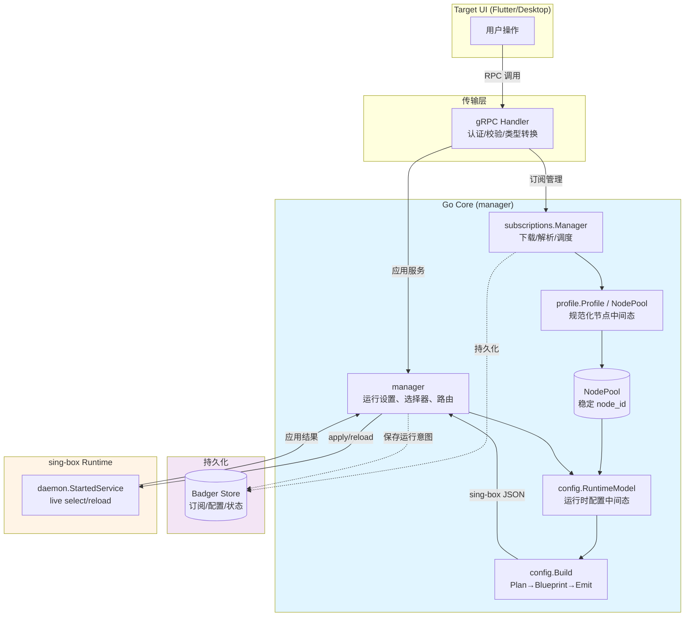
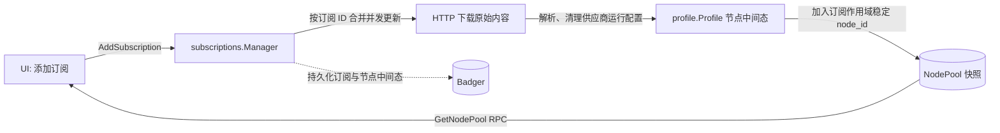
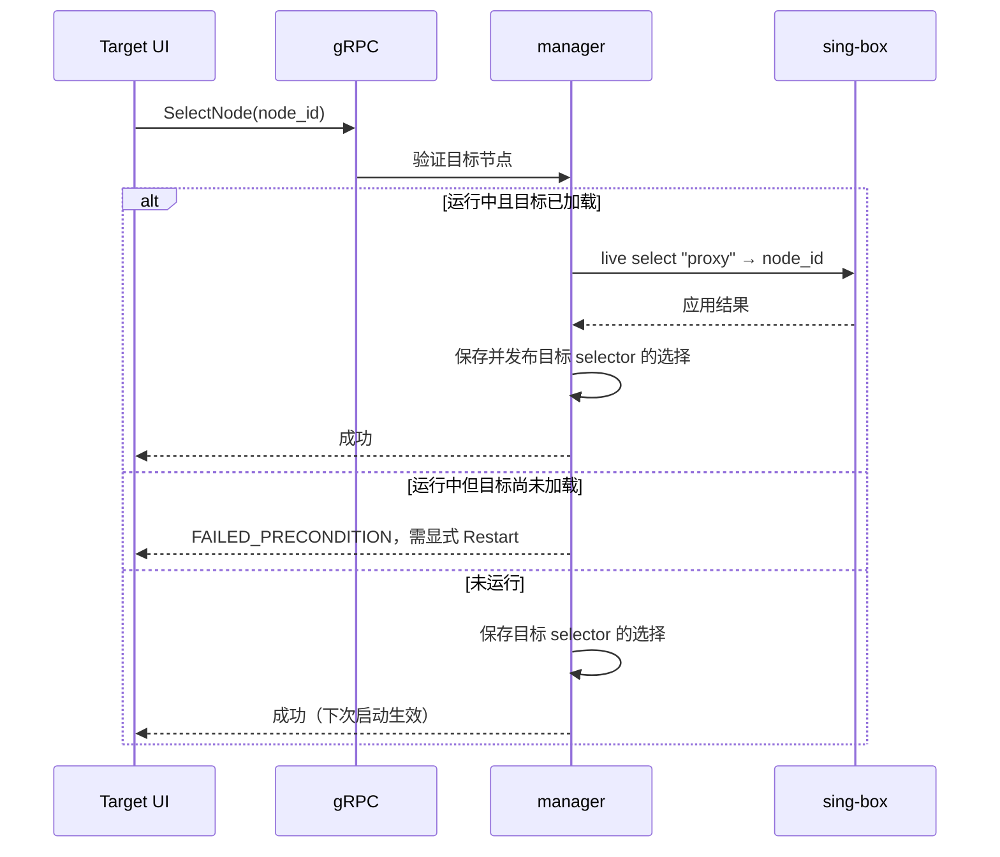
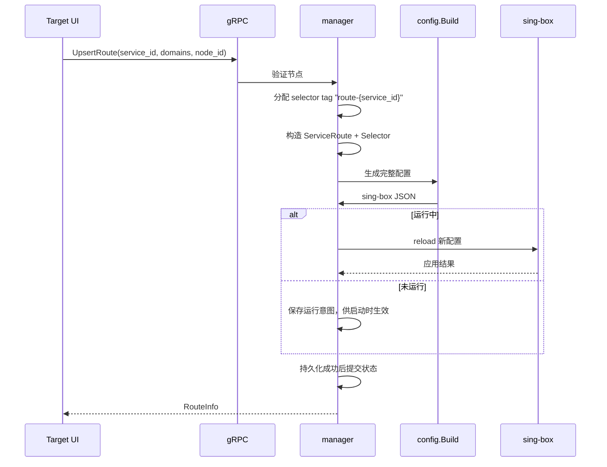
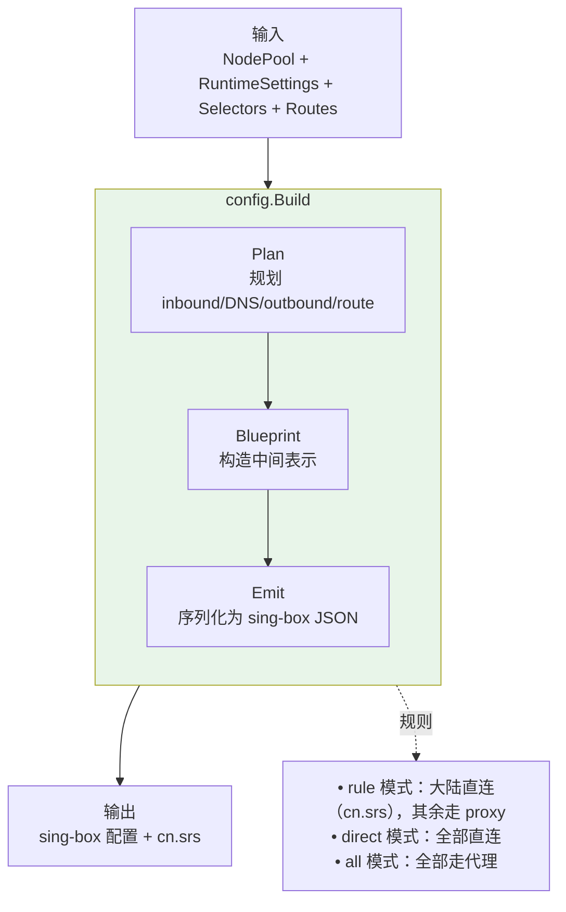

# TargetLib 架构设计

TargetLib 是跨平台 sing-box 管理库，为图形化代理客户端提供核心能力。共享 Go 核心封装订阅管理、节点切换、配置生成和 sing-box 生命周期，gRPC 提供简单同步的控制接口。

## 文档索引

| 文档 | 内容 |
| --- | --- |
| 本文 | 系统架构、数据流、核心边界 |
| [GRPC.md](GRPC.md) | gRPC 接口设计、RPC 分组、使用场景 |

---

## 系统全景

**依赖方向**：只能从外层指向内层。gRPC handler 不承担业务逻辑，manager 不依赖 Flutter/Activity 存活。订阅解析产出节点中间态，manager 将节点池与应用运行意图合并为 `RuntimeModel`，`config.Build` 负责生成 sing-box 配置。

---

## 核心数据流

### 订阅 → 节点池

**关键点**：
- 原始订阅只作解析输入，供应商的 DNS/路由/rule set 不透传
- 解析后的节点中间态供订阅持久化、节点池及运行时配置生成使用
- 可用节点的 `node_id` 由订阅 ID 和清理后的类型化连接参数生成，显示名称和节点顺序不参与计算。订阅刷新后，引用旧算法生成的 ID 的选择需要重新确认。
- 失败时保留上次可用节点池，新订阅失败则回滚

### 节点切换（Layer 1）

`SelectRouteNode` 使用同一流程。启动或重载前，manager 检查已保存的选择是否仍可用。选择失效时返回 `FAILED_PRECONDITION`，可通过节点切换接口显式选择可用的已加载节点或 `direct`，也可停止后选择当前池中的节点再启动。

### 手动节点延迟测试

`manager` 用 `config.Build` 的 `ProbeOnly` 模式启动临时 sing-box 实例，通过指定出站测量延迟。Android 由前台 VPN service 持有的 Go 核心执行。调用方式见 [gRPC 接口](GRPC.md#节点延迟测试)。

### 规则分流（Layer 2）

---

## 配置生成流程

运行时配置以节点中间态和应用运行意图为输入。Start、Restart 和运行中配置变更会生成 sing-box JSON。停止期间的 settings/routes 变更会生成临时配置执行完整检查，随后丢弃内容并只提交运行意图；单独的 selector 选择只做模型校验。

**config.Build 职责**：
- **唯一入口**：`config.Build` 返回 sing-box JSON 及生成配置使用的规范化模型，manager 据此记录已应用状态
- **不透传供应商配置**：订阅的 DNS/路由/rule set/入站/代理组不进入运行时
- **确定性**：相同输入产生相同输出，无隐式状态

---

## 失败处理与一致性

| 失败点 | 核心行为 | 客户端体验 |
| --- | --- | --- |
| 订阅下载/解析失败 | 保留上次可用节点池，按策略退避重试 | 订阅状态显示 failed；现有节点仍可切换 |
| 请求的订阅节点不在池中或不可用 | 拒绝切换 | 返回 `NOT_FOUND` |
| 目标在当前池中，但尚未加载到运行中的 selector | 拒绝切换 | 返回 `FAILED_PRECONDITION`，显式重载后可重试 |
| 启动或重载时已保存的节点不可用 | 保留已保存的选择和当前运行状态 | 返回 `FAILED_PRECONDITION`，需先显式修正选择 |
| live select 失败 | 保持旧节点不变 | 返回错误，UI 显示切换失败 |
| reload 失败 | 重载上次可用配置 | 返回错误，运行时恢复到上次状态 |
| 配置保存失败 | 运行时回滚，不发布事件 | 返回错误，配置未改变 |
| 客户端断开 | 核心继续运行，不影响代理 | 重连后调用 GetProxyStatus 恢复 UI |
| sing-box 崩溃 | 平台重启 service，恢复上次配置 | 状态变为 failed，显示错误信息 |

**核心原则**：
- **同步提交**：只有持久化成功后才发布新运行状态；live selector 持久化失败时尝试恢复原选择
- **异步故障不传播**：订阅更新失败不影响当前代理运行
- **回滚优于降级**：配置应用失败时恢复 last-known-good
- **客户端无状态**：UI 断开重连后通过 GetProxyStatus/ListRoutes 恢复，无需额外同步

---

## 平台部署

| 平台 | 运行方式 | 通信方式 | 关键恢复要求 |
| --- | --- | --- | --- |
| Windows | 系统服务 | TCP 127.0.0.1:19090 | 服务启动时恢复配置和状态 |
| Linux | systemd service | TCP / Unix socket | systemd 重启后恢复 |
| macOS | launchd / 独立进程 | TCP / Unix socket | launchd 恢复与网络变化回调 |
| Android | 前台 VpnService（独立进程）| 进程内通信 | START_STICKY 空 Intent、TUN 重建、Flutter 脱离后继续 |
| iOS | Network Extension | 受限 IPC | extension 生命周期内恢复 |

### Android 特殊要求

- **独立进程**：`:targetlib` 前台 VpnService 独立于 Flutter Activity
- **生命周期**：Activity 销毁不影响代理运行
- **恢复**：`START_STICKY` 确保系统杀死后自动重启
- **通信**：Flutter 通过本地 socket 连接核心（非跨进程）

---

## 当前整理点

- `profile.Node` 在内存中只保留类型化 outbound；Badger 边界使用持久化投影编码节点配置。
- NodePool revision 在订阅状态快照发布时计算，读取节点池时只复制并排序节点。
- manager 以内存 `runtimeIntent` 处理 settings、selectors 和 routes。持久化使用独立的 CBOR 记录，protobuf 只用于 gRPC。
- 升级后使用新的订阅和运行意图存储键。已有订阅需要重新导入，运行设置、节点选择和服务分流需要重新配置。
- Emit 序列化 Blueprint。manager 在应用或保存候选配置前调用 sing-box `CheckConfig` 做完整检查，sing-box 在启动或重载时解析配置以创建实例。

---

## 核心边界与约束

- **gRPC 只是传输层**：不承担运行时策略、评分、探测调度
- **selector/route/binding 构造由核心独占**：客户端只提供 `node_id` 和 `domains`
- **原始订阅只作解析输入**：供应商的运行时选项不透传
- **config.Build 是唯一入口**：所有 sing-box 配置生成必须经过此函数
- **TUN/密钥/存储路径由宿主实现**：平台能力通过回调注入
- **Flutter UI 只提交意图并渲染 snapshot**：不实现评分、探测调度或构造完整 RuntimeModel
- **Android 长期任务由前台 VPN service 执行**：不依赖 Activity/Flutter engine 存活
